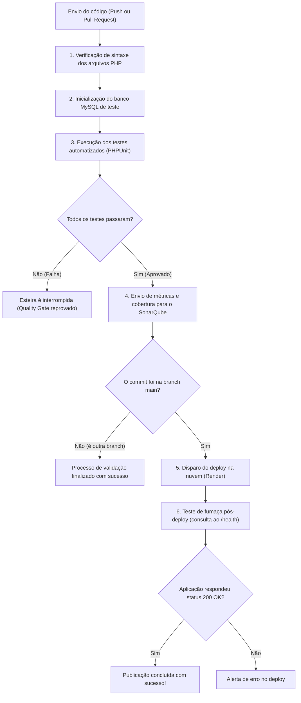

# Relatório de Implantação de DevOps, Integração Contínua (CI) e Implantação Contínua (CD)

**Projeto:** Sistema HBL Control — Controle de Livros Didáticos (PNLD)  
**Grupo:** G1 — Projeto PNLD  
**Integrantes:**
- Helena Dantas Mariano ([@HelenaMariano2025](https://github.com/HelenaMariano2025))
- Isabelle Cavalcanti da Silva ([@Isabellecavalcant](https://github.com/Isabellecavalcant))
- Jaine Souza da Luz ([@JaineSouz](https://github.com/JaineSouz))

**Repositório:** [https://github.com/HelenaMariano2025/projetoPNLD](https://github.com/HelenaMariano2025/projetoPNLD)  
**Data:** Novembro de 2026  

---

## 1. O que é este documento e qual o seu objetivo

Nesta etapa final do projeto (P5), a equipe organizou uma esteira automatizada completa de **Integração Contínua (CI)** e **Implantação Contínua (CD)**.

O objetivo principal é garantir que qualquer alteração feita no código do sistema passe automaticamente por testes antes de ser publicada. Dessa forma, se algum teste falhar, o sistema não é atualizado com erros. Além disso, assim que a publicação é feita, a esteira executa um teste rápido (chamado de teste de fumaça ou *Smoke Test*) para conferir se o sistema realmente subiu e está respondendo na internet.

---

## 2. Como a esteira funciona (Visão Geral)

A automação foi configurada utilizando o **GitHub Actions** através do arquivo `.github/workflows/ci.yml`.

A esteira é dividida em três fases:

1. **CI (Integração Contínua):** Roda a cada push ou abertura de Pull Request. Confere a sintaxe dos arquivos PHP (`php -l`), executa a análise estática (`PHPStan`), prepara o banco de dados MySQL de testes, roda os testes unitários e de integração no PHPUnit, calcula a cobertura de código e envia as métricas para o SonarQube do LABENS. *(Os testes E2E com Selenium ficam isolados na suíte `e2e` via `docker-compose.yml` para manter a esteira de PR rápida e determinística, sem dependência de navegador no runner).*
2. **CD (Implantação Contínua):** Só roda quando as alterações são enviadas para a branch principal (`main`) e todos os testes da CI passaram. Ela aciona o serviço na nuvem para atualizar a versão no ar.
3. **Smoke Tests (Testes de Fumaça pós-deploy):** A esteira faz chamadas na URL pública da aplicação (`/health`) para verificar se ela está no ar e respondendo corretamente (código HTTP 200).

### Diagrama da esteira



---

## 3. A Cultura DevOps no Projeto

A adoção de DevOps trouxe melhorias práticas para o dia a dia da equipe:

- **Fim do problema "na minha máquina funciona":** Como utilizamos Docker, o PHP e o banco de dados rodam exatamente com a mesma versão e configuração no computador de cada integrante, no GitHub Actions e na nuvem.
- **Testar o mais cedo possível (*Shift-Left*):** Em vez de deixar para testar manualmente só no final do semestre ou na hora de entregar, a esteira roda os testes a cada alteração enviada. Se uma mudança quebrar uma regra antiga, o problema é apontado na mesma hora.
- **Conferir o sistema em funcionamento real (*Shift-Right*):** Além de testar o código isolado, a esteira agora confere se a aplicação publicada na internet está de fato operando através do endpoint `/health`.

---

## 4. Ambiente Escolhido para Publicação

A equipe optou por publicar a aplicação em **plataforma em nuvem (Render)** utilizando contêineres Docker:

- **Por que essa escolha foi feita:** O Render permite publicar contêineres Docker de forma automatizada via Webhook (*Deploy Hook*), já disponibiliza certificado de segurança SSL (HTTPS) gratuito e conecta diretamente com o repositório do projeto.
- **Uso seguro de senhas:** Nenhuma senha ou chave de acesso fica gravada no código. As chaves de disparo e a URL do sistema ficam salvas nos *GitHub Secrets* do repositório.
- **Compatibilidade com o ambiente da disciplina:** O arquivo `docker-compose.yml` que criamos também permite subir a aplicação com banco MySQL e Selenium localmente ou no servidor da disciplina da mesma forma.

---

## 5. Como Executar o Projeto Localmente com Docker

Qualquer pessoa da equipe ou avaliador pode rodar todo o sistema e o banco de dados no computador seguindo os passos abaixo:

### Pré-requisitos
- Ter o Docker e o Docker Compose instalados no computador.

### Passo a passo
1. Baixe o repositório e abra a pasta no terminal:
   ```bash
   git clone https://github.com/HelenaMariano2025/projetoPNLD.git
   cd projetoPNLD
   ```

2. Inicie os contêineres:
   ```bash
   docker compose up -d
   ```
   *(Esse comando baixa as imagens, cria o banco de dados, aplica as tabelas iniciais e inicia a aplicação na porta 8080).*

3. Acesse no navegador:
   - Sistema: [http://localhost:8080/index.html](http://localhost:8080/index.html)
   - Verificação de saúde: [http://localhost:8080/health](http://localhost:8080/health)

4. Para parar os contêineres:
   ```bash
   docker compose down
   ```

### Como rodar os testes manualmente
Caso deseje rodar a suíte de testes no terminal:
```bash
vendor/bin/phpunit --configuration phpunit.xml
```

---

## 6. Variáveis de Ambiente

O sistema utiliza as seguintes variáveis para se comunicar com o banco de dados e os serviços:

| Variável | Para que serve | Valor local padrão |
|---|---|---|
| `DB_HOST` | Endereço do banco de dados | `db` (no Docker) ou `127.0.0.1` |
| `DB_USER` | Usuário do banco | `pnld` |
| `DB_PASSWORD` | Senha do banco | `pnld_local` (ou `pnldpassword`) |
| `DB_NAME` | Nome do banco de dados | `SistemaHBL` |
| `PORT` | Porta em que o PHP escuta | `8080` |
| `RENDER_DEPLOY_HOOK` | Link secreto para acionar o deploy na nuvem | Configurado no GitHub Secrets |
| `APP_BASE_URL` | Endereço público do sistema na internet | Configurado no GitHub Secrets |
| `SONAR_TOKEN` | Chave de acesso do SonarQube do LABENS | Configurado no GitHub Secrets |

---

## 7. Links de Acesso

- **Issue no repositório do projeto:**  
  [https://github.com/HelenaMariano2025/projetoPNLD/issues/54](https://github.com/HelenaMariano2025/projetoPNLD/issues/54)
- **Issue no repositório da disciplina (bsi-tasks):**  
  [https://github.com/tacianosilva/bsi-tasks/issues/618](https://github.com/tacianosilva/bsi-tasks/issues/618)
- **Repositório do projeto:**  
  [https://github.com/HelenaMariano2025/projetoPNLD](https://github.com/HelenaMariano2025/projetoPNLD)
- **Arquivo da esteira de CI/CD:**  
  [https://github.com/HelenaMariano2025/projetoPNLD/blob/main/.github/workflows/ci.yml](https://github.com/HelenaMariano2025/projetoPNLD/blob/main/.github/workflows/ci.yml)
- **Sistema publicado na internet:**  
  [https://projetopnld.onrender.com](https://projetopnld.onrender.com)
- **Endpoint de integridade (/health):**  
  [https://projetopnld.onrender.com/health](https://projetopnld.onrender.com/health)
- **Painel do SonarQube no LABENS:**  
  [http://labens.dct.ufrn.br/sonarqube/dashboard?id=pnldkey](http://labens.dct.ufrn.br/sonarqube/dashboard?id=pnldkey)

---

## 8. Resultados e Evidências

### 8.1 Endpoint de integridade (`/health`)
Ao acessar o endereço `/health`, a aplicação retorna um texto em formato JSON confirmando que está funcionando:

```json
{
    "status": "healthy",
    "database": "connected",
    "service": "Sistema HBL - PNLD",
    "timestamp": "2026-11-25T00:30:00-03:00"
}
```

### 8.2 Teste de fumaça pós-deploy (Smoke Test)
No log do GitHub Actions, o teste de fumaça faz requisições até confirmar que a aplicação respondeu com código 200 (OK):

```text
Aguardando estabilização da aplicação em: https://projetopnld.onrender.com/health
Tentativa 1: requisitando https://projetopnld.onrender.com/health...
Código HTTP retornado: 200
Smoke test aprovado: Aplicação operacional e respondendo status 200 OK!
```

### 8.3 Situação dos testes e Quality Gate
- Mais de **190 testes automatizados** cadastrados e aprovados, cobrindo regras de negócio, páginas e banco de dados.
- **Cobertura em Código Novo no SonarQube:** **96,9%** (exigido `>= 80,0%`), com **0% de duplicação**.
- **Quality Gate no SonarQube do LABENS:** Aprovado (*Passed*), com **0 issues abertas** e **0 security hotspots** (nota **A**), atendendo integralmente aos critérios de qualidade exigidos pela disciplina.
