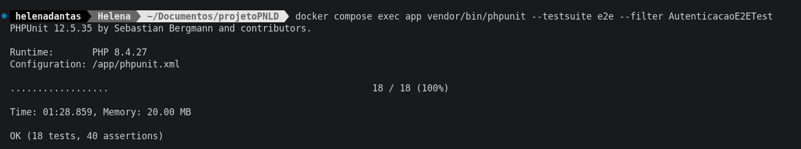
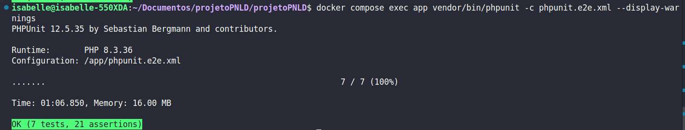

## 10. Prática 1 — Automação de testes de sistema com Selenium 

### 10.1. Ambiente e configuração

| Item | Valor |
|---|---|
| Ferramenta | Selenium WebDriver, com a biblioteca `php-webdriver/webdriver` (versão resolvida pelo Composer, ver `composer.lock`) |
| Framework de testes | PHPUnit 12.5.35 |
| PHP | 8.4.27 |
| Servidor Selenium | Selenium Standalone 4.52.0, imagem `selenium/standalone-chrome` |
| Navegador | Chrome 157.0.8103.38, em modo *headless* |
| Data da execução | 08/11/2026 |

**Instalação da biblioteca** (substitui a simulação `--dry-run` da seção 6.2):

```bash
docker compose up --build -d
docker compose exec app composer require --dev php-webdriver/webdriver
docker compose exec app composer dump-autoload
```

**Serviço Selenium no `compose.yaml`.** O contêiner compartilha a rede do `app`, de modo que o navegador acessa a aplicação em `http://localhost:8000`:

```yaml
  selenium:
    image: selenium/standalone-chrome:latest
    shm_size: "2gb"
    network_mode: "service:app"
    depends_on:
      - app
```

**Suíte `e2e` no `phpunit.xml`**, separada da suíte padrão para que a cobertura e o Sonar não tentem executá-la:

```xml
<testsuite name="e2e">
    <directory suffix="Test.php">tests-e2e</directory>
</testsuite>
```

**Execução:**

```bash
docker compose up -d
docker compose exec app vendor/bin/phpunit --testsuite e2e --filter AutenticacaoE2ETest
```

**Arquivos:**

| Arquivo | Função |
|---|---|
| `tests-e2e/NavegadorTestCase.php` | Classe base: abre o navegador, preenche campos, aguarda textos e URLs, captura tela em caso de falha |
| `tests-e2e/AutenticacaoE2ETest.php` | Testes do fluxo de cadastro e autenticação |

### 10.2. Problemas encontrados durante a configuração

| # | Sintoma | Ação adotada |
|---|---|---|
| 1 | O Chrome do contêiner `selenium` não abria `http://app:8000` (`net::ERR_CONNECTION_CLOSED`); a conexão com o servidor Selenium estava correta | O serviço Selenium passou a usar `network_mode: "service:app"`, e a aplicação é acessada por `http://localhost:8000` |
| 2 | Após o primeiro login, os campos do formulário permaneciam vazios nos logins seguintes dentro do mesmo navegador, e os testes falhavam por tempo esgotado | Cada teste passou a abrir um navegador novo (método `setUp`). A causa exata não foi identificada. O comportamento foi observado por um script de diagnóstico, e a mudança eliminou o problema |

Uma hipótese levantada e descartada: o servidor embutido do PHP atender uma requisição por vez. O ajuste testado não alterou o resultado.

### 10.3. Fluxo implementado (Cadastro e Login)

Fluxo: **cadastro e login** (US01 e US02). Total de **18 testes** (os 8 do TA02.06 vêm de um *data provider*):

| Teste | Cenário (User Stories) | Resultado esperado |
|---|---|---|
| `testTA0101...` | TA01.01 + TA02.01: cadastrar administrador e autenticar com a nova conta | Mensagem de sucesso; login redireciona para `funcoes.php` |
| `testCadastroExigeCamposObrigatorios` (3 casos) | TA01.02, TA01.03, TA01.04: campo obrigatório ausente | Mensagem de campo obrigatório |
| `testTA0201...` | TA02.01: credenciais válidas | Redireciona para `funcoes.php` |
| `testTA0202...` | TA02.02: senha incorreta | "Matrícula ou senha inválida." |
| `testTA0203...` | TA02.03: matrícula não cadastrada | "Matrícula ou senha inválida." |
| `testTA0204...` | TA02.04: campos vazios | "Matrícula e senha são obrigatórias." |
| `testTA0205...` | TA02.05: administrador autenticado acessa as telas | Nenhum redirecionamento ao login |
| `testTA0206...` (8 rotas) | TA02.06: acesso direto sem autenticação | Redireciona para `login.php` |
| `testLogoutEncerraASessao` | Encerramento de sessão | Após o logout, páginas restritas redirecionam ao login |

Rotas do TA02.06: `/turmas.php`, `/aluno.php`, `/livros.php`, `/emprestimosDevolucoes.php`, `/historico.php`, `/add_turma.php`, `/addEmprestimo.php` e `/cadastro.php`. A rota `/devolverLivro.php` ficou de fora do teste porque altera dados mesmo por requisição GET.

### 10.4. Execução ANTES da correção

A suíte, ainda sem o teste de logout (17 testes), revelou **4 falhas**, todas do cenário TA02.06:

```text
docker compose exec app vendor/bin/phpunit --testsuite e2e --filter AutenticacaoE2ETest
PHPUnit 12.5.35 by Sebastian Bergmann and contributors.

Runtime:       PHP 8.4.27
Configuration: /app/phpunit.xml

..........F...FFF                                                 17 / 17 (100%)

Time: 01:40.959, Memory: 20.00 MB

There were 4 failures:

1) Tests\E2E\AutenticacaoE2ETest::testTA0206AcessoDiretoSemAutenticacaoRedirecionaAoLogin#1 with data ('/aluno.php')
A URL não contém 'login.php'. URL atual: http://localhost:8000/aluno.php

/app/tests-e2e/NavegadorTestCase.php:135
/app/tests-e2e/AutenticacaoE2ETest.php:131

2) Tests\E2E\AutenticacaoE2ETest::testTA0206AcessoDiretoSemAutenticacaoRedirecionaAoLogin#5 with data ('/add_turma.php')
A URL não contém 'login.php'. URL atual: http://localhost:8000/add_turma.php

/app/tests-e2e/NavegadorTestCase.php:135
/app/tests-e2e/AutenticacaoE2ETest.php:131

3) Tests\E2E\AutenticacaoE2ETest::testTA0206AcessoDiretoSemAutenticacaoRedirecionaAoLogin#6 with data ('/addEmprestimo.php')
A URL não contém 'login.php'. URL atual: http://localhost:8000/addEmprestimo.php

/app/tests-e2e/NavegadorTestCase.php:135
/app/tests-e2e/AutenticacaoE2ETest.php:131

4) Tests\E2E\AutenticacaoE2ETest::testTA0206AcessoDiretoSemAutenticacaoRedirecionaAoLogin#7 with data ('/cadastro.php')
A URL não contém 'login.php'. URL atual: http://localhost:8000/cadastro.php

/app/tests-e2e/NavegadorTestCase.php:135
/app/tests-e2e/AutenticacaoE2ETest.php:131

FAILURES!
Tests: 17, Assertions: 33, Failures: 4.
```

### 10.5. Defeitos encontrados e correção

Os testes de sistema encontraram **defeitos reais de controle de acesso** na aplicação:

| Página | Defeito (antes) | Correção (depois) |
|---|---|---|
| `aluno.php` | Aberta sem login: qualquer visitante podia cadastrar, editar e inativar alunos | `exigirAutenticacao()` no início |
| `add_turma.php` | Aberta sem login | `exigirAutenticacao()` após o início da sessão |
| `addEmprestimo.php` | Formulário aberto sem login (só o envio era validado) | `exigirAutenticacao()` após o autoload |
| `devolverLivro.php` | Alterava dados por GET sem verificar login | `exigirAutenticacao()` após o autoload |
| `cadastro.php` | Público: qualquer pessoa criava um administrador e já saía logada como ele | Restrito a administrador autenticado; a sessão do novo administrador deixa de ser criada no cadastro |
| Sessão | Não existia logout, e o ID da sessão não mudava no login | Novo `logout.php`; `session_regenerate_id` no login (`regenerarSessao()`) |
| Navegação | Links públicos para o cadastro em `index.html` e `login.php` | Removidos; o menu do administrador passou a ter "Cadastrar administrador" |

Pull Request: [fix/#46-restringir-acesso-admin](https://github.com/HelenaMariano2025/projetoPNLD/pull/48).

**Regressão (PHPUnit):** após as alterações, a suíte existente permaneceu verde.

```text
docker compose exec app vendor/bin/phpunit
Tests: 191, Assertions: 576, Deprecations: 1.
OK, but there were issues!
```

As mensagens de erro do MySQL exibidas durante a execução vêm de testes que provocam essas falhas de propósito.

### 10.6. Execução DEPOIS da correção

Execução intermediária, já com o teste de logout (18 testes). As páginas `/aluno.php`, `/add_turma.php` e `/cadastro.php` já redirecionavam, e restava uma falha:

```text
PHPUnit 12.5.35 by Sebastian Bergmann and contributors.

Runtime:       PHP 8.4.27
Configuration: /app/phpunit.xml

................F.                                                18 / 18 (100%)

Time: 01:13.100, Memory: 20.00 MB

There was 1 failure:

1) Tests\E2E\AutenticacaoE2ETest::testTA0206AcessoDiretoSemAutenticacaoRedirecionaAoLogin#6 with data ('/addEmprestimo.php')
A URL não contém 'login.php'. URL atual: http://localhost:8000/addEmprestimo.php

/app/tests-e2e/NavegadorTestCase.php:135
/app/tests-e2e/AutenticacaoE2ETest.php:142

FAILURES!
Tests: 18, Assertions: 39, Failures: 1.
```

A falha ocorreu porque a chamada de exigirAutenticacao() foi posicionada incorretamente após session_start(), quando deveria estar após o require_once __DIR__ . '/vendor/autoload.php'. Após identificar o erro, a chamada foi reposicionada corretamente, permitindo a execução dos testes E2E sem falhas.

Execução final, após corrigir `addEmprestimo.php`:

```text
PHPUnit 12.5.35 by Sebastian Bergmann and contributors.

Runtime:       PHP 8.4.27
Configuration: /app/phpunit.xml

..................                                                18 / 18 (100%)

Time: 01:28.859, Memory: 20.00 MB

OK (18 tests, 40 assertions).
```

### 10.7. Comparativo antes × depois

| Cenário | Antes | Depois |
|---|---|---|
| Rotas restritas redirecionam ao login (TA02.06) | 4 de 8 falhavam | 8 de 8 aprovados |
| Logout encerra a sessão | Funcionalidade inexistente | Funcionalidade implementada e aprovada |
| Total | 13 aprovados, 4 falhas (17 testes) | 18 aprovados, 0 falhas (18 testes) |

**Evidência visual:**



### 10.8. Limitações

- A suíte E2E depende de três serviços ativos (aplicação, banco e Selenium) e fica fora da suíte padrão do PHPUnit.
- Cada teste abre um navegador novo, o que torna a execução mais lenta: 18 testes em cerca de 1 minuto e 13 segundos.
- A execução em integração contínua (GitHub Actions) ainda não foi implementada.
- A causa exata da perda de digitação após o primeiro login (item 2 da seção 10.2) não foi identificada.
- Os testes cobrem o fluxo de cadastro e login. Os fluxos de alunos e turmas e de livros e empréstimos são cobertos pelos outros integrantes.

### 10.9. Fluxo 3 — Gerenciamento de livros e registro de empréstimos

O terceiro fluxo de automação de testes de sistema contempla as histórias de usuário **US05 (Gerenciar livros)** e **US06 (Registrar empréstimos)**. A implementação utilizou Selenium WebDriver e PHPUnit, permitindo simular as interações de um administrador com a interface do sistema e verificar o comportamento das funcionalidades diretamente no navegador.

**Cenários implementados:**

Foram desenvolvidos seis testes funcionais, distribuídos entre as duas histórias de usuário, além de um teste para verificar a conexão com o servidor Selenium.

| Arquivo | História | Critério | Cenário testado |
|---|---|---|---|
| `CadastroLivroE2ETest.php` | US05 | TA05.01 | Cadastro de um livro |
| `EdicaoLivroE2ETest.php` | US05 | TA05.03 | Edição de um livro cadastrado |
| `ExclusaoLivroE2ETest.php` | US05 | TA05.04 | Exclusão de um livro |
| `EmprestimoValidoE2ETest.php` | US06 | TA06.01 | Registro de empréstimo com dados válidos |
| `EmprestimoSemAlunoE2ETest.php` | US06 | TA06.04 | Tentativa de registro de empréstimo sem informar o aluno |
| `EmprestimoLivroIndisponivelE2ETest.php` | US06 | TA06.06 | Tentativa de empréstimo de livro indisponível |
| `ConexaoSeleniumTest.php` | — | — | Verificação da comunicação com o servidor Selenium |

Os cenários foram elaborados para verificar tanto operações realizadas com sucesso quanto situações em que o sistema deve impedir o prosseguimento de uma operação devido à ausência de informações obrigatórias ou à indisponibilidade de um exemplar.

### 10.10. Problemas encontrados durante a implementação

Durante a implementação dos testes de gerenciamento de livros, foi identificado um problema na inicialização da sessão da página `livros.php`. Essa situação interferia no acesso à funcionalidade durante a execução automatizada.

Após a análise, foi necessário corrigir a inicialização da sessão na página, permitindo que o fluxo de gerenciamento de livros fosse acessado corretamente pelo navegador controlado pelo Selenium.

Também foram realizados ajustes nos cenários de empréstimo para contemplar diferentes condições de entrada, incluindo a ausência de aluno informado e a indisponibilidade do livro selecionado.

### 10.11. Execução dos testes

A execução dos testes foi realizada por meio do PHPUnit, utilizando a configuração específica da suíte E2E:

```bash
docker compose exec app vendor/bin/phpunit -c phpunit.e2e.xml --display-warnings
```

A configuração permite executar os testes utilizando o ambiente da aplicação, o banco de dados e o navegador disponibilizado pelo Selenium.

### 10.12. Resultado da execução

Na execução conjunta registrada, foram obtidos os seguintes resultados:

```text
PHPUnit 12.5.35 by Sebastian Bergmann and contributors.

Runtime:       PHP 8.3.36
Configuration: /app/phpunit.e2e.xml

.......                                                             7 / 7 (100%)

Time: 01:06.850, Memory: 16.00 MB

OK (7 tests, 21 assertions)
```

Os sete testes foram aprovados, totalizando 21 asserções, sem falhas na execução.

**Evidência visual:**



### 10.13. Considerações sobre o fluxo

A implementação contribuiu para ampliar a cobertura dos testes de sistema, contemplando operações relacionadas ao gerenciamento do acervo e ao registro de empréstimos.

Os testes permitiram verificar o comportamento da aplicação diante de operações válidas e inválidas, além de identificar um problema relacionado à inicialização da sessão durante o acesso à página de gerenciamento de livros.

Dessa forma, o Fluxo 3 complementou os demais fluxos automatizados pelo grupo, contribuindo para a verificação das funcionalidades previstas nas histórias de usuário US05 e US06.

### 10.9. Fluxo 2 — Gerenciamento de Turmas e Alunos (US03 e US04)

O segundo fluxo de automação de testes de sistema contempla as histórias de usuário US03 (Gerenciar alunos) e US04 (Gerenciar turmas). A implementação foi realizada por Jaine, utilizando Selenium WebDriver, `php-webdriver` e Chrome executado em Docker.

O objetivo foi automatizar o cadastro, a consulta e a pesquisa de turmas e alunos, além de verificar regras de validação e operações de gerenciamento.

**Responsável:** Jaine  
**Arquivo:** `tests-e2e/TurmaAlunoE2ETest.php`  
**Issue:** [#46](https://github.com/HelenaMariano2025/projetoPNLD/issues/46)

#### 10.9.1. Cenários implementados

Os testes foram elaborados com base nos cenários de aceitação definidos em `docs/004-lista-users-stories.md`.

| Cenário | Descrição | Teste |
|---|---|---|
| TA04.01 | Cadastrar turma | `testFluxoCompletoCadastroConsultaEPesquisa` |
| TA04.05 | Pesquisar turma pelo curso | `testFluxoCompletoCadastroConsultaEPesquisa` |
| TA03.01 | Cadastrar aluno vinculado a uma turma | `testFluxoCompletoCadastroConsultaEPesquisa` |
| TA03.02 | Consultar aluno e visualizar a turma | `testFluxoCompletoCadastroConsultaEPesquisa` |
| TA03.07 | Pesquisa de aluno sem resultado | `testFluxoCompletoCadastroConsultaEPesquisa` |
| Regra | Recusar código de turma repetido | `testNaoPermiteTurmaComCodigoRepetido` |
| Regra | Recusar matrícula de aluno repetida | `testNaoPermiteAlunoComMatriculaRepetida` |
| Regra | Impedir exclusão de turma com aluno vinculado | `testNaoExcluiTurmaComAlunoVinculado` |
| Extra | Inativar aluno | `testInativarAluno` |

Cada teste utiliza dados únicos, como código, curso, matrícula e nome gerados aleatoriamente, permitindo executar a suíte várias vezes sem precisar limpar o banco de dados.

#### 10.9.2. Ambiente e execução

O ambiente utilizado foi composto por:

| Item | Valor |
|---|---|
| PHP | 8.4.27 |
| PHPUnit | 12.5.35 |
| Biblioteca | php-webdriver |
| Servidor Selenium | Selenium Grid 4.52.0 |
| Navegador | Chrome 157 (`selenium/standalone-chrome`) |
| Servidor PHP | Servidor embutido com `PHP_CLI_SERVER_WORKERS=4` |

Para executar diretamente o arquivo de testes:

```bash
docker compose exec app vendor/bin/phpunit tests-e2e/TurmaAlunoE2ETest.php
```

Os testes foram executados na máquina da colega Helena. Na máquina da autora, o Docker disponibilizava aproximadamente 1,8 GB de memória, e o Chrome levou 2 minutos e 42 segundos apenas para iniciar a sessão, inviabilizando a execução local.

Por esse motivo, a autora também utilizou o sistema local, sem Selenium, para reproduzir manualmente os defeitos identificados.

#### 10.9.3. Problemas encontrados durante a implementação

Durante o desenvolvimento, foram realizadas cinco execuções da suíte, com ajustes progressivos nos testes.

| Execução | Resultado | Problema identificado |
|---|---|---|
| 1 | 5 testes, 5 falhas e 12 asserções | Mensagens de sucesso do cadastro de turma não eram encontradas. |
| 2 | 5 testes, 5 falhas e 59 asserções | Os campos passaram a ser conferidos, mas o segundo envio do formulário não funcionava. |
| 3 | 5 testes, 4 falhas e 69 asserções | O envio por `requestSubmit()` permitiu avançar no cadastro de turma, mas o cadastro de aluno apresentou um erro na aplicação. |
| 4 | 5 testes, 2 erros, 1 falha e 81 asserções | Após a correção do erro no cadastro, restaram problemas na pesquisa e nas confirmações do navegador. |
| 5 | 5 testes, 88 asserções e nenhuma falha | Todos os cenários foram aprovados. |

**Preenchimento dos campos e envio dos formulários**

Nas primeiras execuções, algumas interações do Selenium não preenchiam os campos corretamente. Em determinadas situações, a validação `required` do navegador impedia o envio.

O teste passou a conferir o valor de cada campo após o preenchimento e, quando necessário, a utilizar scripts para completar os valores.

Mesmo depois de corrigir o preenchimento, os formulários continuavam sem ser enviados. Os logs do servidor (`docker compose logs app`) não registravam requisições `POST` após o último `GET`.

Como o ajuste `PHP_CLI_SERVER_WORKERS=4` já estava ativo e não resolveu o problema, o envio passou a ser realizado por meio de `form.requestSubmit()`.

**Pesquisa de alunos**

O clique no botão "Buscar" não enviava o formulário de pesquisa, fazendo com que a página continuasse exibindo todos os alunos.

Isso comprometia a validação do cenário TA03.02, pois o aluno poderia aparecer na listagem mesmo sem a aplicação efetiva do filtro.

O teste passou a conferir o campo de pesquisa e a enviar o formulário pelo navegador, garantindo que a consulta fosse realmente realizada.

**Janelas de confirmação**

As operações de exclusão de turma e inativação de aluno exibem uma confirmação do navegador (`confirm`). Os testes apresentavam `TimeoutException` ao aguardar essa confirmação.

O código foi ajustado para aceitar a confirmação por script.

#### 10.9.4. Defeito encontrado no sistema (BUG-01)

Durante as execuções 3 e 4, foi identificado um defeito que impedia o cadastro de alunos.

Ao clicar em "Cadastrar aluno", o navegador exibia o seguinte erro:

```text
Fatal error: Uncaught Error: Class "AlunoValidator" not found
in /app/aluno.php on line 62
```

A investigação identificou que a classe estava declarada com outro nome: `AlunoValidador`, no arquivo `php/AlunoValidador.php`.

O arquivo era carregado corretamente por `aluno.php`, mas duas chamadas, nas linhas 65 e 91, utilizavam o nome incorreto `AlunoValidator`.

Os testes unitários de `tests/AlunoValidadorTest.php` utilizavam o nome correto e, por isso, não detectavam o problema. O teste E2E identificou o defeito porque percorreu o fluxo real de cadastro pela interface.

A correção consistiu em substituir as duas chamadas de `AlunoValidator::` por `AlunoValidador::`.

**Commit da correção:** `fix: corrige nome da classe AlunoValidador em aluno.php`.

Após a alteração, o cadastro de alunos passou a funcionar.

#### 10.9.5. Resultado final da execução

Após os ajustes nos formulários, na pesquisa, nas confirmações e na correção do BUG-01, a suíte foi executada novamente:

```bash
docker compose exec app vendor/bin/phpunit tests-e2e/TurmaAlunoE2ETest.php
```

Resultado:

```text
PHPUnit 12.5.35 by Sebastian Bergmann and contributors.

Runtime:       PHP 8.4.27
Configuration: /app/phpunit.xml

.....                                                       5 / 5 (100%)

Time: 00:36.185, Memory: 20.00 MB

OK (5 tests, 88 assertions)
```

Os cinco testes foram aprovados, totalizando 88 asserções, sem falhas.

Também foi realizado um teste manual na máquina da autora. Com o sistema em execução local, o cadastro de turma exibiu a mensagem "Turma cadastrada com sucesso!".

#### 10.9.6. Evidências

As capturas de tela e os arquivos HTML gerados durante as falhas estão armazenados em `tests-e2e/evidencias/`.

As evidências registram a evolução das execuções:

- **Execução 1:** formulários com campos vazios ou sem mensagem de retorno.
- **Execução 2:** campos preenchidos, mas com falha no envio subsequente.
- **Execução 3:** formulários preenchidos, ausência de requisições `POST` nos logs e identificação do erro `AlunoValidator`.
- **Execução 4:** cadastro de aluno funcionando, mas com falhas na pesquisa e nas confirmações.
- **Execução 5:** aprovação dos cinco testes, com 88 asserções.

#### 10.9.7. Achados sobre o sistema

Além dos problemas que interferiam na execução automatizada, foram observadas algumas características da aplicação:

- **BUG-01 confirmado:** `aluno.php` utilizava `AlunoValidator`, enquanto a classe existente se chamava `AlunoValidador`. Isso impedia o cadastro de alunos até a correção.
- **Diferença entre operações:** para alunos, o sistema oferece a opção "Inativar", enquanto a US03 (TA03.05) descreve a operação como "excluir".
- **Diferença nas mensagens:** a mensagem de sucesso do cadastro de aluno aparece após um redirecionamento, utilizando sessão. Já a mensagem de sucesso do cadastro de turma aparece na própria página.

Também foram identificados pontos que precisam de investigação adicional, mas que não devem ser classificados como defeitos confirmados sem testes específicos:

- `add_turma.php` e `aluno.php` aparentemente não chamavam `exigirAutenticacao()` no início da execução. É necessário verificar o acesso a essas páginas sem autenticação.
- A opção "Sair" aparentemente apenas redirecionava para `index.html`. É necessário verificar se a sessão é realmente encerrada.

#### 10.9.8. Limitações

- A execução automatizada foi realizada na máquina de uma colega devido à limitação de memória da máquina da autora.
- Os testes criam registros no banco de dados local. O sistema não exclui alunos, apenas permite inativá-los.
- O envio dos formulários e a aceitação das confirmações são realizados por script, e não por clique real do usuário, pois as interações de clique do Selenium não funcionaram de maneira confiável nesse ambiente.
- Dessa forma, os testes não verificam a aparência dos botões nem o aspecto visual das janelas de confirmação.
- A hipótese de que o clique falhava devido ao layout da página, com o botão parcialmente fora da tela, não foi confirmada.

